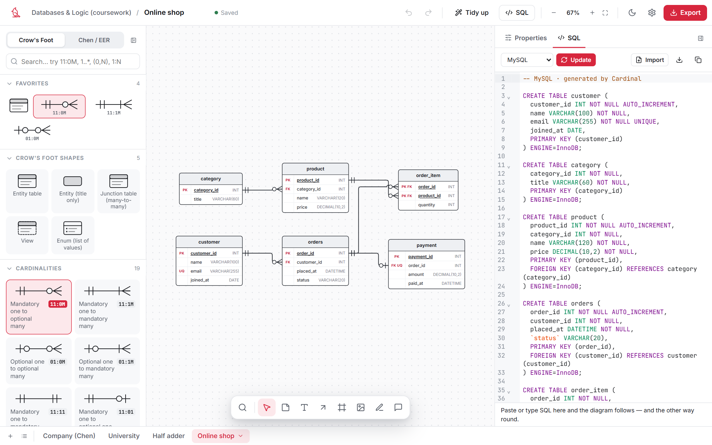
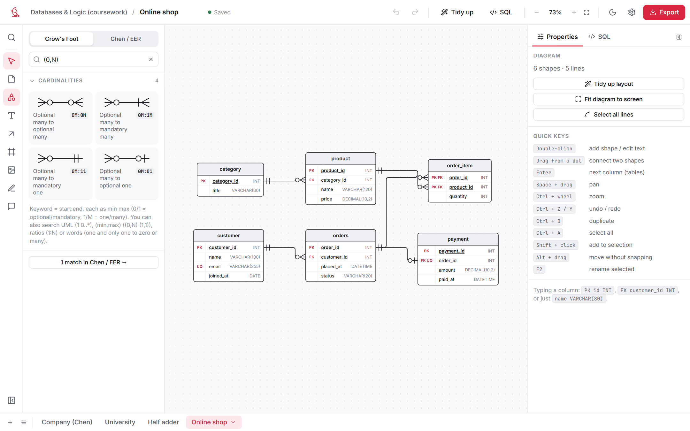
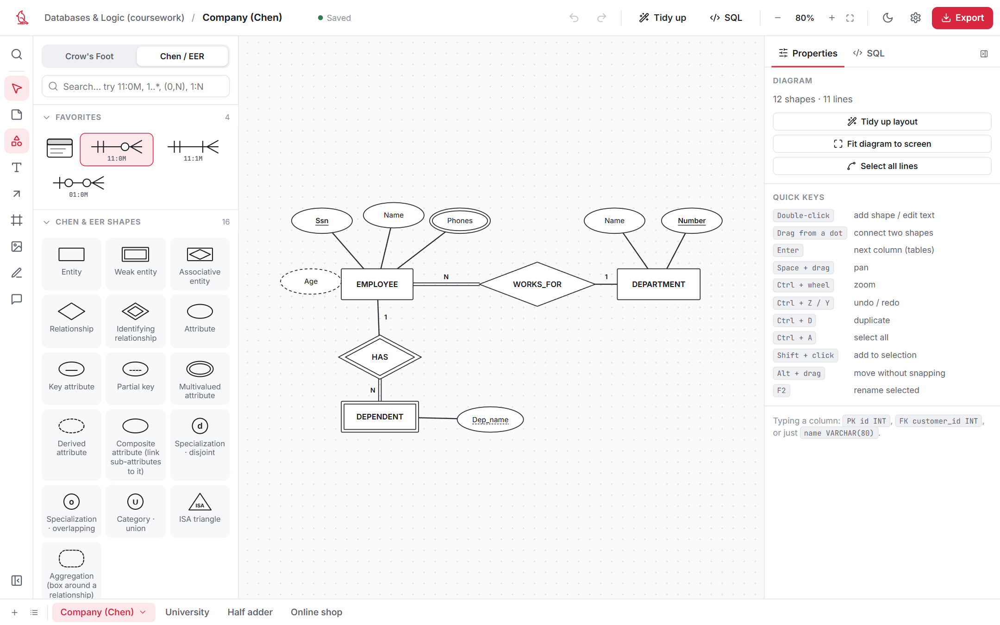
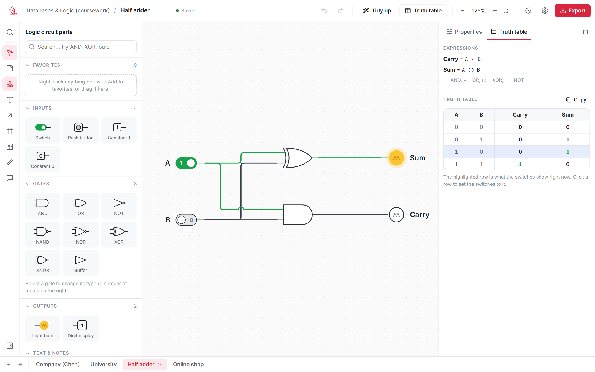
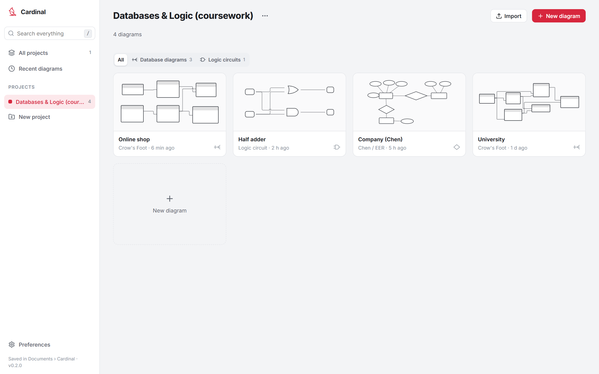

<p align="center">
  
</p>

<h1 align="center">Cardinal</h1>

<p align="center">
  <b>ER diagrams, SQL and logic circuits. Offline, free, and the lines route themselves.</b><br>
  A little desktop app for Windows and Mac.
</p>

<p align="center">
  <a href="../../releases/latest/download/Cardinal-Windows-Setup.exe"><b>⬇ Download for Windows</b></a>
  &nbsp;·&nbsp;
  <a href="../../releases/latest/download/Cardinal-macOS.dmg"><b>⬇ Download for Mac</b></a>
  &nbsp;·&nbsp;
  <a href="../../releases/latest">All releases</a>
</p>

<picture>
  <source media="(prefers-color-scheme: dark)" srcset="docs/screenshots/er-sql-dark.png">
  
</picture>

---

## Why this exists

I had a databases module and a digital logic module in the same semester. Every week meant drawing Crow's Foot diagrams, Chen diagrams and logic circuits, and every tool I tried was either online-only, behind a paywall, or made me drag line corners around by hand for twenty minutes.

So I built the thing I wanted: something that *feels* like Lucidchart, runs on my own laptop with no account and no internet, and is smart enough that the lines just go where they should.

**Cardinal is for you if:**

- you're a student doing **databases** (ERDs, EER, SQL) or **digital logic** (gates, truth tables)
- you want Lucidchart-style diagrams **offline and free**
- you'd rather type `11:0M` than hunt for the right crow's foot in a menu

## What it can do

### Database diagrams that keep up with you

Crow's Foot tables with PK / FK / UQ / NN / AI keys, or Chen / EER with entities, relationships, weak entities, multivalued and derived attributes, specialization and ISA. You choose when you make the diagram and can switch any time.

- **Lines route themselves.** Right angles around other shapes, no overlaps, little hops where lines cross. Move a table and everything re-routes.
- **Rows connect to rows.** Drag from the dot on `customer_id` to the dot on the other table's PK. Picking a foreign key in the row editor draws the line for you.
- **Type a whole row at once.** `FK customer_id INT` in any cell fills the key, the name and the type.

### SQL ↔ diagram, both ways

Paste a pile of `CREATE TABLE` statements and the tables appear. Edit the diagram and the SQL updates. It works with MySQL, PostgreSQL, SQLite and SQL Server.

Broken SQL doesn't wipe your diagram. The good statements still apply, and the bad line gets underlined, with a little ⚠ on the table it belongs to. Click the ⚠ to jump to the line.

### A cardinality library that speaks every dialect

Every lecturer writes cardinality differently. Cardinal's search understands all of it:



Type `11:0M`, `1 0..*`, `(0,N)`, `1:N` or even *"one and only one to zero or many"*, and you get the right line. The cheat sheet is [further down](#notation-cheat-sheet).

### Chen / EER, the way the slides draw it

<picture>
  <source media="(prefers-color-scheme: dark)" srcset="docs/screenshots/chen-dark.png">
  
</picture>

### Logic circuits with a live simulation

Switches, push buttons, constants, AND / OR / NOT / NAND / NOR / XOR / XNOR / buffer (2 to 8 inputs), light bulbs and digit displays. Click a switch and the wires light up green. The **truth table** and the **Boolean expression** for every output build themselves, and you can copy the table straight into Sheets or Word.

<picture>
  <source media="(prefers-color-scheme: dark)" srcset="docs/screenshots/circuit-dark.png">
  
</picture>

### And the everyday stuff

- **General shapes** (flowchart, arrows, containers, people), sticky notes, text, a pen, images and comments
- **Page tabs** like Google Sheets, so one project can hold every diagram for a module
- **Light and dark mode**
- **Export** to PNG, SVG, PDF, SQL or a `.cardinal.json` file
- **Undo / redo**, copy / paste, align, and *Tidy up* for when things get messy

<picture>
  <source media="(prefers-color-scheme: dark)" srcset="docs/screenshots/home-dark.png">
  
</picture>

## Download

| | |
|---|---|
| 🪟 **Windows 10 / 11** | [**Cardinal-Windows-Setup.exe**](../../releases/latest/download/Cardinal-Windows-Setup.exe) |
| 🍎 **macOS 10.15+** (Intel and Apple Silicon) | [**Cardinal-macOS.dmg**](../../releases/latest/download/Cardinal-macOS.dmg) |

**Heads up: Cardinal isn't code-signed.** Signing certificates cost money every year, and this is a free student project. So the first time you open it, your computer will warn you. It's safe, and here's how to get past it:

<details>
<summary><b>Windows: "Windows protected your PC"</b></summary>

1. Run `Cardinal-Windows-Setup.exe`.
2. SmartScreen shows a blue box. Click **More info**.
3. Click **Run anyway**.
4. The installer doesn't need admin rights. Cardinal goes into your Start menu.

</details>

<details>
<summary><b>Mac: "Cardinal can't be opened" / "Apple could not verify…"</b></summary>

1. Open `Cardinal-macOS.dmg` and drag **Cardinal** into **Applications**.
2. Open Cardinal once. macOS blocks it. Click **Done** (not *Move to Trash*).
3. Open **System Settings → Privacy & Security**, scroll down to *Security*, and click **Open Anyway** next to the Cardinal message.
4. Confirm with your password or Touch ID. From now on it opens normally.

The first time it saves, macOS may ask whether Cardinal can use your **Documents** folder. Say **Allow**, because that's where your projects live.

</details>

## Quick start

**Your first database diagram (about 30 seconds)**

1. **New project**, give it a name, then **New diagram → Database diagram → Create**.
2. **Double-click** the empty canvas. A table appears. Type its name and press **Enter**.
3. **Double-click** the `id` row and press **Enter** to start a new row. Type a whole row like `name VARCHAR(80)` or `FK customer_id INT` and press **Enter** again for the next one.
4. Make a second table. Hover the first one, then drag from a **blue dot** onto the second to connect them.
5. Pick a line end from the **Cardinalities** library (try typing `11:0M` in the search box).
6. Click **SQL** at the top to see the code. Or skip steps 2–5 and paste your own SQL there.

**Your first circuit**

1. **New diagram → Logic circuit**, tick **Start from an example (half adder)**, then **Create**.
2. Click the switches. The wires and bulbs follow along.
3. Open **Truth table** on the right. Clicking a row sets the switches to match.
4. To build your own, drag a switch, a gate and a bulb in from the left, then drag from pin to pin to wire them.

## Notation cheat sheet

Cardinal names each Crow's Foot end with two characters, **min then max**:

| Crow's Foot | In words | Cardinal | UML | (min,max) |
|---|---|:---:|:---:|:---:|
| ┼┼ | one and only one (mandatory one) | `11` | `1` | `(1,1)` |
| ○┼ | zero or one (optional one) | `01` | `0..1` | `(0,1)` |
| ┼< | one or many (mandatory many) | `1M` | `1..*` | `(1,N)` |
| ○< | zero or many (optional many) | `0M` | `0..*` | `(0,N)` |

A whole line is written **`start:end`**, so `11:0M` means *one and only one* → *zero or many* (a classic one-to-many, like customer → orders).

> ⚠️ **(min,max) sits on the opposite ends.** In Crow's Foot and UML, the marks next to a table describe *the other side*. In (min,max) notation, the pair next to an entity describes *how often that entity takes part*. So `11:0M` in Crow's Foot is written `(0,N)` at the start and `(1,1)` at the end. Cardinal's search knows this and flips them for you. Hover any line in the library to see every equivalent.

Ratios work too: `1:1`, `1:N`, `M:N`.

## What's next

Things I'd like to add, roughly in this order (the full list with details is in **[ROADMAP.md](ROADMAP.md)**):

1. **Flowchart mode**: flowcharts as their own diagram type, with Yes/No labels on decisions, top-to-bottom tidy-up and starter examples
2. **Canvas comfort**: a minimap, alignment guides while dragging, manual waypoints on lines, and a templates gallery
3. **Chen → SQL**: turn a Chen / EER diagram into tables so it can export SQL too
4. **Circuit polish**: junction dots and shared wires when one output feeds several inputs, plus rotating and flipping parts
5. **Bigger circuit stuff**: expression → circuit, K-maps, flip-flops, a clock, multiplexers, 7-segment displays and custom chips

Got an idea or found a bug? [Open an issue](../../issues).

## Privacy

Everything stays on your computer. Projects are plain JSON files in **Documents/Cardinal** (`projects/`, `diagrams/`, `settings/`). There's no account, no cloud, no analytics, and the app never phones home. To back up, copy that folder, or keep it inside OneDrive / Google Drive / iCloud. Deleted diagrams go to a `.trash` folder in there, not into the void.

## Run from source

<details>
<summary><b>Windows: double-click <code>build.bat</code></b></summary>

You need these once:

| Install | Why |
|---|---|
| [**Node.js LTS**](https://nodejs.org) | builds the web part of the app (React + Vite) |
| [**Rust** via rustup](https://rustup.rs) | builds the small desktop shell (Tauri). Run `rustup-init.exe` and accept the defaults. |
| [**Visual Studio Build Tools**](https://visualstudio.microsoft.com/visual-cpp-build-tools/), workload *Desktop development with C++* | Rust uses Microsoft's C++ linker on Windows. Skip this if you already have Visual Studio with C++. |
| WebView2 | the engine that draws the app. It's already part of Windows 10 / 11. |

Then double-click **`build.bat`**. It installs the packages, builds a debug version of the app and opens it. The first build compiles Rust and takes a few minutes; after that it's quick. Your projects are the same ones as in the installed app (Documents\Cardinal).

**No Rust?** `Cardinal/Start Cardinal.bat` runs Cardinal in your browser instead, through a tiny local Node server. It saves to the same folder.

</details>

<details>
<summary><b>Any OS: terminal</b></summary>

```bash
cd Cardinal
npm install
npm run tauri dev      # desktop app with hot reload
npm run dev            # or just the web app at http://localhost:5177
npm run tauri build    # installers in Cardinal/src-tauri/target/release/bundle
```

</details>

Releases are built by GitHub Actions (`.github/workflows/release.yml`) whenever a version tag like `v0.2.0` is pushed.

## Built with

[React](https://react.dev) + [TypeScript](https://www.typescriptlang.org) + [Vite](https://vitejs.dev) · [Tauri](https://tauri.app) for the desktop app · [Zustand](https://github.com/pmndrs/zustand) for state · [CodeMirror 6](https://codemirror.net) for the SQL editor · [dagre](https://github.com/dagrejs/dagre) for *Tidy up* · [jsPDF](https://github.com/parallax/jsPDF) for PDF export · [Lucide](https://lucide.dev) icons · [Inter](https://rsms.me/inter/) and [JetBrains Mono](https://www.jetbrains.com/lp/mono/) fonts.

The line router (A* on a sparse orthogonal grid, with lane separation and hops) and the SQL parser are home-made, as is the cardinal. It's a bird, it's red, and it's drawn with one line.

<p align="center"><sub>Made by a student who just wanted to finish their ERD homework faster. 🐦</sub></p>
