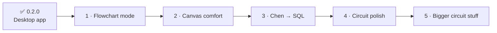

# 🗺️ Cardinal roadmap

What's coming next, roughly in order. Nothing here has a date. Cardinal is built in between assignments, so things land when they land. 🐦

Have an idea, or want something moved up? [Open an issue](../../issues) and say why. Real coursework pain gets priority.

---

## ✅ Done (0.2.0)

- Desktop app for **Windows and Mac**, with one-click installers on [Releases](../../releases/latest)
- Crow's Foot and Chen / EER diagrams with self-routing lines
- Two-way SQL ↔ diagram (MySQL, PostgreSQL, SQLite, SQL Server) with error markers
- Cardinality search that understands `11:0M`, UML, (min,max), ratios and plain English
- Logic circuits with live simulation, truth tables and Boolean expressions
- Keyboard shortcuts everywhere (press <kbd>?</kbd> in the app)

---

## 1 · Flowchart mode

Cardinal already has the standard flowchart shapes (Start/end, Process, Decision, Data, Document and more). They're tucked away in a database diagram's library, though. Flowcharts deserve their own diagram type, like logic circuits have.

- [ ] **Flowchart** as a third card in *New diagram*, with a flowchart-first library
- [ ] **Yes / No labels** on lines leaving a Decision, filled in for you
- [ ] **Top-to-bottom layout** for *Tidy up*, so loops and branches line up the way textbooks draw them
- [ ] Starter examples: *if / else*, *while loop*, *find the largest number*
- [ ] *Maybe later:* pseudocode → flowchart (type the steps, get the diagram)

## 2 · Canvas comfort

Small things that make big diagrams nicer to work on.

- [ ] **Minimap** in the corner, for finding your way around big diagrams
- [ ] **Alignment guides** while dragging (those little pink snap lines)
- [ ] **Manual waypoints**: drag a bend into a line when the router's choice isn't what you want
- [ ] **Templates gallery**: library system, online shop, hospital, university, half adder…

## 3 · Chen → SQL

- [ ] Turn a Chen / EER diagram into tables (entities → tables, relationships → foreign keys or junction tables, multivalued attributes → their own table), so Chen diagrams can export SQL too.

## 4 · Circuit polish

- [ ] **Junction dots** and shared wires when one output feeds several inputs
- [ ] **Rotate and flip** parts

## 5 · Bigger circuit stuff

- [ ] **Expression → circuit**: type `A·B + ¬C` and get the gates
- [ ] **K-maps** and simplification
- [ ] **Flip-flops**, a **clock**, **multiplexers** and **7-segment displays**
- [ ] **Custom chips**: wrap a circuit into a reusable block

---

## 💭 Ideas, not planned yet

- Auto-update inside the app
- Code-signing, so the "unknown publisher" warning goes away (it costs money every year, so not yet)

This file mirrors the project's internal checklist. Last updated for 0.2.0.
